# 数牧增效 ESP32-S3 主控 + MaixCam 边缘 AI 完整落地方案

## 1. 结论：STM32 能不能换成 ESP32

可以换，但建议换成 `ESP32-S3`，不建议换成普通 `ESP32-WROOM-32`。

原因如下：

| 对比项 | STM32L476 | 普通 ESP32 | ESP32-S3 | 建议 |
|---|---|---|---|---|
| 环境传感器采集 | 稳定 | 可行 | 可行 | ESP32-S3 可替代 |
| 执行器控制 | 稳定 | 可行 | 可行 | ESP32-S3 可替代 |
| WiFi/MQTT | 需外接 ESP8266 | 原生支持 | 原生支持 | ESP32-S3 更简洁 |
| 蓝牙 | 需外接模块 | 支持 BLE | 支持 BLE 5 | ESP32-S3 更适合扩展项圈 |
| AI/TinyML 余量 | 有限 | 有限 | 更强 | ESP32-S3 更适合项目叙述 |
| 摄像头 AI | 不适合 | 不适合 | 可做轻量，但不建议主做 | 仍由 MaixCam 负责 |
| 低功耗 | 强 | 中等 | 中等 | 需通过分时采集控制功耗 |
| 开发生态 | STM32Cube/Keil | ESP-IDF/Arduino | ESP-IDF/Arduino | ESP32-S3 更利于联网 |

推荐最终架构：

- `ESP32-S3` 替代 `STM32L476 + ESP8266`，作为环境监测、执行控制、MQTT 网关和本地告警主控。
- `MaixCam` 继续作为独立视觉边缘 AI 节点，运行开源 YOLO 模型和自优化算法。
- 云端平台接收 ESP32-S3 的环境数据和 MaixCam 的视觉事件。

不建议的做法：

- 不建议让 ESP32-S3 同时承担摄像头视觉识别主任务。ESP32-S3 可做轻量分类或简单图像处理，但牛只检测、卧倒、打斗等视觉任务仍应交给 MaixCam。
- 不建议把 MaixCam 当普通摄像头只上传视频。这样会增加网络压力，也失去边缘 AI 的价值。

## 2. 新版系统总体架构

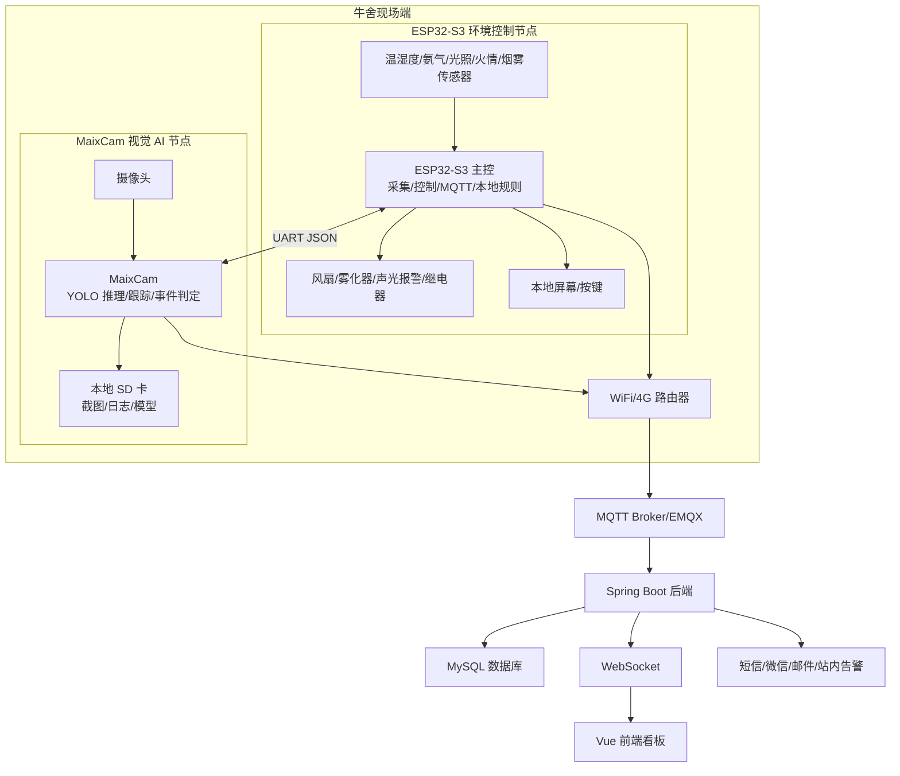

## 3. 硬件组成

### 3.1 核心硬件

| 模块 | 推荐器件 | 作用 | 落地说明 |
|---|---|---|---|
| 主控网关 | ESP32-S3-WROOM-1 / ESP32-S3-DevKitC | 传感器采集、控制、MQTT、WiFi | 替代 STM32 + ESP8266 |
| 视觉 AI | Sipeed MaixCam | 牛只检测、异常行为识别、事件截图 | 独立运行 AI，不依赖云端 |
| 存储 | microSD | MaixCam 本地保存模型、图片、日志 | 建议 16GB 以上 |
| 通信 | WiFi / 4G 路由器 | 连接 MQTT Broker | 牛舍 WiFi 弱时用 4G |
| 本地交互 | OLED/LCD + 按键 | 显示状态、调试参数 | 可选，但竞赛展示有价值 |

### 3.2 传感器与执行器

| 类别 | 推荐器件 | 接口 | 说明 |
|---|---|---|---|
| 温湿度 | AHT20 / SHT31 | I2C | 替代 DHT11，稳定性更好 |
| 氨气 | MQ-137 原型版 / 工业 NH3 RS485 正式版 | ADC / RS485 | MQ-137 做趋势，工业传感器做计量 |
| 光照 | BH1750 | I2C | 数字光照强度 |
| 火情 | 火焰传感器 + 烟雾传感器 | GPIO/ADC | 单一火焰传感器容易误报 |
| 风扇 | MOSFET/继电器/SSR | GPIO/PWM | 根据功率选驱动 |
| 雾化器 | 继电器/MOSFET | GPIO | 做强弱电隔离 |
| 声光报警 | 蜂鸣器 + 警示灯 | GPIO/PWM | 本地即时告警 |
| 可选项圈 | ESP32-C3 + MPU6050 | BLE/ESP-NOW | 二期扩展单牛姿态 |
| 声音采集 | INMP441 / ICS-43434 数字 I2S 麦克风 | I2S | 采集咳嗽、喘鸣、异常叫声等声学特征 |
| 定向拾音 | 防水驻极体麦克风 + 前置放大 | ADC/I2S 模块 | 牛舍噪声大时用于定向采集 |
| 局部高清巡检 | MaixCam 定点抓拍 / 人工手持补拍 | 图像 | 皮肤、眼睛、鼻部疾病筛查需要近距离清晰图像 |

## 4. ESP32-S3 硬件连接

### 4.1 推荐接口分配

| ESP32-S3 接口 | 连接对象 | 用途 |
|---|---|---|
| I2C0 SDA/SCL | AHT20/SHT31、BH1750 | 温湿度和光照采集 |
| ADC1_CHx | MQ-137 模拟输出、烟雾模拟输出 | 氨气趋势和烟雾强度 |
| GPIO OUT | 继电器/MOSFET | 风扇、雾化器、声光报警 |
| PWM GPIO | 风扇调速/蜂鸣器 | 可选 |
| UART1 | MaixCam | 接收视觉事件、发送抓拍指令 |
| I2S | INMP441/ICS-43434 麦克风 | 声音采集，识别咳嗽、喘鸣、异常叫声 |
| UART0/USB | 调试下载 | 固件烧录和日志 |
| SPI | LCD 或扩展模块 | 本地显示 |
| RS485 UART | 工业 NH3/温湿度传感器 | 正式版预留 |

### 4.2 ESP32-S3 与 MaixCam 串口连接

| ESP32-S3 | MaixCam | 说明 |
|---|---|---|
| TXD1 | RX | ESP32-S3 下发命令 |
| RXD1 | TX | MaixCam 上报事件 |
| GND | GND | 共地 |
| 5V/3.3V | 不建议互供 | 两块板独立供电 |

连接要求：

- UART 电平统一为 3.3V TTL。
- MaixCam 和 ESP32-S3 独立供电，但必须共地。
- 串口波特率建议 `115200`，事件量大时可提高到 `921600`。
- 串口消息使用一行一个 JSON，方便调试。

### 4.3 供电设计

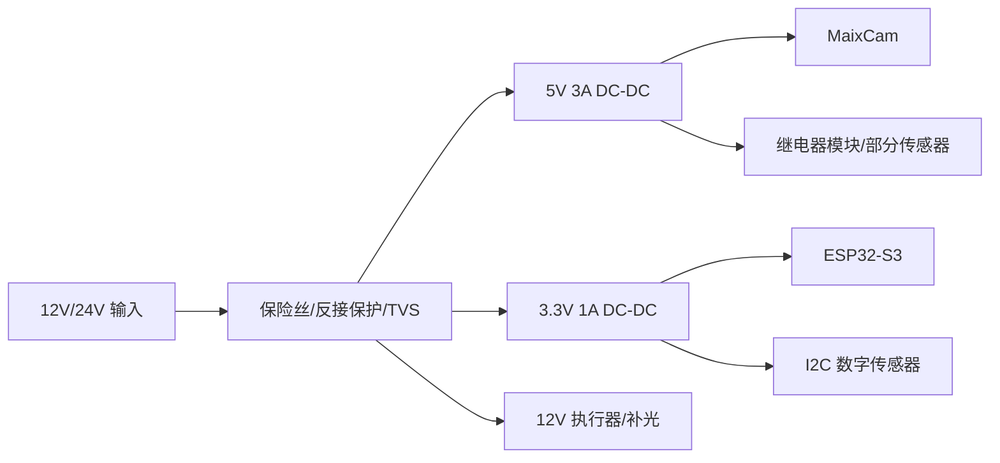

供电要求：

- MaixCam 单独一路 5V，建议电源能力不低于 2A。
- ESP32-S3 使用稳定 3.3V，瞬态电流要留余量。
- 舵机、继电器、风扇不要直接从 ESP32-S3 板载 5V 取电。
- 风扇、雾化器等感性负载必须加续流和浪涌保护。

## 5. 数据传输总流程

### 5.1 全链路数据流

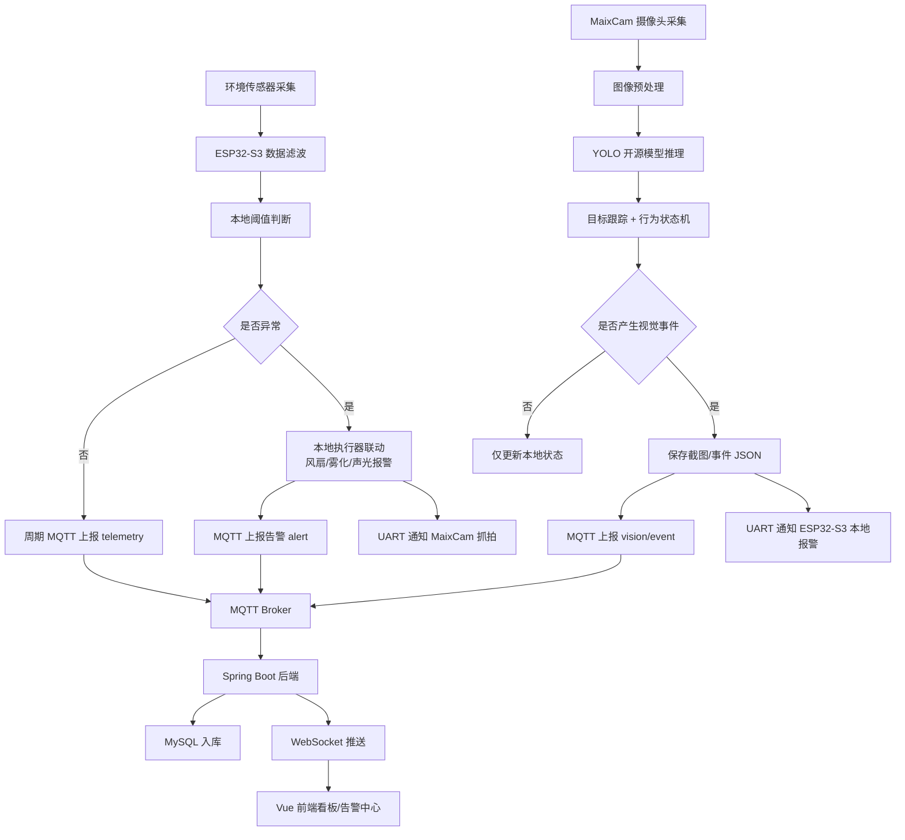

### 5.2 环境数据传输流程

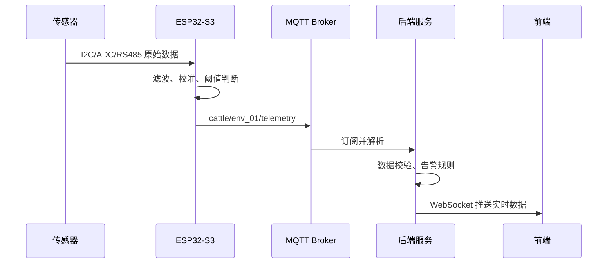

### 5.3 视觉事件传输流程

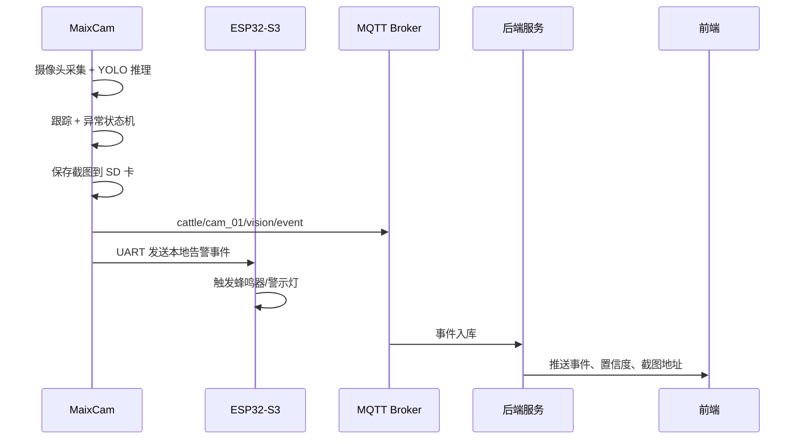

### 5.4 环境异常触发抓拍流程

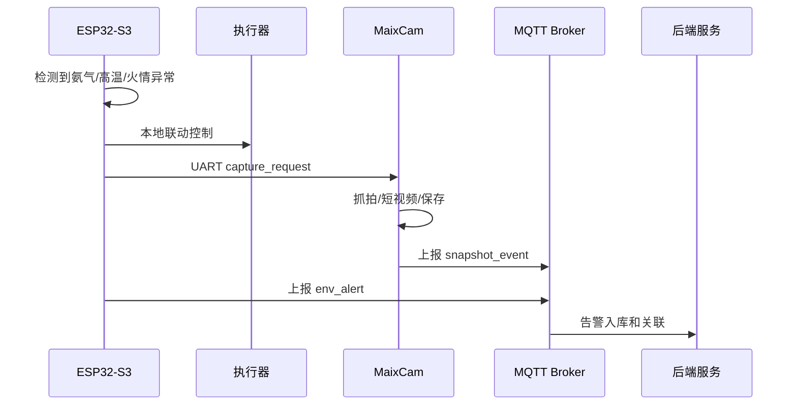

### 5.5 断网缓存流程

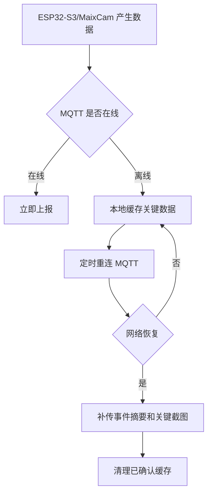

### 5.6 声音与疾病风险数据流

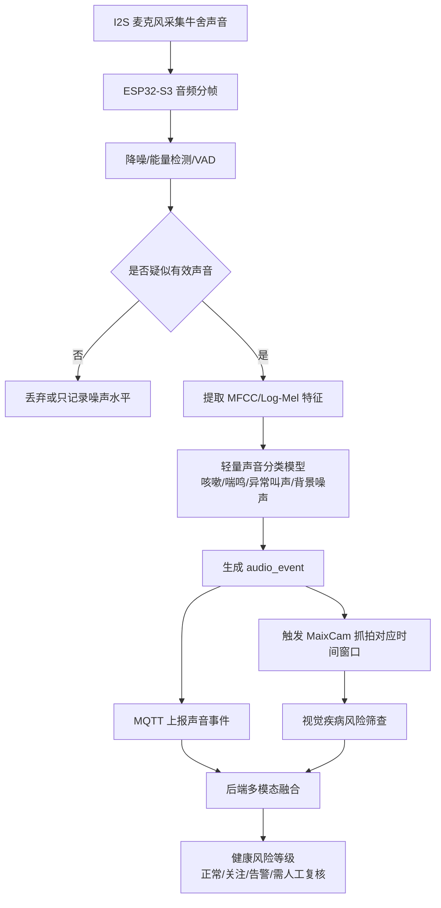

### 5.7 多模态疾病风险判断流程

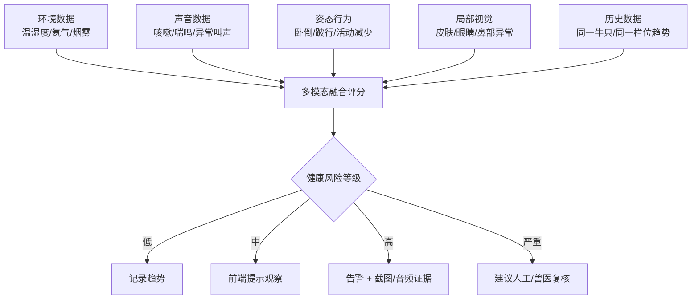

## 6. MQTT Topic 与 Payload

### 6.1 Topic 设计

```text
cattle/{barnId}/{deviceId}/telemetry
cattle/{barnId}/{deviceId}/alert
cattle/{barnId}/{deviceId}/status
cattle/{barnId}/{cameraId}/vision/event
cattle/{barnId}/{cameraId}/vision/status
cattle/{barnId}/{deviceId}/audio/event
cattle/{barnId}/{cameraId}/health/risk
cattle/{barnId}/{deviceId}/cmd
cattle/{barnId}/{cameraId}/vision/config
```

### 6.2 ESP32-S3 环境数据

```json
{
  "deviceId": "env_01",
  "barnId": "barn_01",
  "ts": 1715500800,
  "temperature": 27.3,
  "humidity": 68.1,
  "nh3Raw": 1820,
  "nh3Status": "high",
  "lightLux": 230,
  "smokeRaw": 310,
  "fan": true,
  "atomizer": false,
  "alarm": false,
  "rssi": -62
}
```

### 6.3 MaixCam 视觉事件

```json
{
  "cameraId": "cam_01",
  "barnId": "barn_01",
  "ts": 1715500800,
  "eventType": "fall_suspect",
  "level": "warning",
  "score": 0.86,
  "trackId": 3,
  "bbox": [120, 80, 260, 210],
  "durationSec": 180,
  "snapshotPath": "cam_01/20260512_120000.jpg",
  "modelName": "yolov8n-cattle",
  "modelVersion": "v1.0.0"
}
```

### 6.4 声音事件数据

```json
{
  "deviceId": "env_01",
  "barnId": "barn_01",
  "ts": 1715500800,
  "eventType": "cough_suspect",
  "score": 0.82,
  "durationMs": 1200,
  "snr": 14.6,
  "audioFeature": "mfcc",
  "audioClipPath": "audio/env_01/20260512_120000.wav",
  "modelName": "cattle-audio-cnn",
  "modelVersion": "v1.0.0"
}
```

### 6.5 健康风险融合结果

```json
{
  "barnId": "barn_01",
  "targetId": "track_03",
  "ts": 1715500800,
  "riskType": "respiratory_risk",
  "riskLevel": "warning",
  "score": 0.78,
  "evidence": {
    "audio": ["cough_suspect", "wheeze_suspect"],
    "vision": ["nasal_discharge_suspect", "low_activity"],
    "environment": ["nh3_high", "humidity_high"]
  },
  "suggestion": "建议人工复核该栏位牛只呼吸道症状"
}
```

### 6.6 ESP32-S3 发给 MaixCam 的 UART 命令

```json
{"type":"capture_request","reason":"nh3_high","durationMs":3000}
```

```json
{"type":"config_update","roi":[[30,40],[300,40],[300,220],[30,220]],"fallSeconds":180,"scoreThreshold":0.55}
```

### 6.7 MaixCam 发给 ESP32-S3 的 UART 事件

```json
{"type":"vision_event","event":"fall_suspect","level":"warning","score":0.86,"trackId":3}
```

## 7. 开源算法选择

### 7.1 视觉检测算法

推荐使用开源 YOLO 系列：

- `YOLOv8n`：文档完善，训练方便，适合自定义数据集。
- `YOLOv5n`：部署资料多，端侧转换案例多。
- `YOLO11n`：更靠近新版本生态，但项目申报中 YOLOv8 更稳妥。

第一期建议：

- 使用 `YOLOv8n` 训练牛只检测模型。
- 端侧部署到 MaixCam。
- 类别数量控制在 3 到 5 个。

推荐类别：

```text
cattle_stand
cattle_lie
cattle_head
person
background_difficult 可不作为正式类别，只做负样本
```

### 7.2 行为识别算法

第一期不建议直接训练复杂行为分类网络。采用：

```text
YOLO 目标检测
  + 轻量目标跟踪
  + ROI 区域规则
  + 时间状态机
  + 多帧投票
```

优点：

- 数据需求比端到端行为识别小。
- 可以解释，便于写申报书和调试。
- 现场误报后可以快速调阈值。
- MaixCam 更容易稳定运行。

### 7.3 可选开源组件

| 功能 | 开源方案 |
|---|---|
| 模型训练 | Ultralytics YOLOv8 |
| 标注 | LabelImg / CVAT / Roboflow |
| 数据增强 | Albumentations / YOLO 内置增强 |
| 跟踪 | ByteTrack 思路简化版 / SORT 思路简化版 |
| 边缘部署 | MaixPy 模型部署工具链 |
| 后端通信 | MQTT / EMQX |
| 可视化 | Vue + ECharts |

### 7.4 声音识别开源算法

声音识别建议使用开源音频分类路线，不建议第一期直接上大模型。推荐路线：

```text
I2S 麦克风音频
  -> VAD/能量检测
  -> 降噪
  -> MFCC 或 Log-Mel 频谱
  -> 轻量 CNN / MobileNet / YAMNet 迁移学习
  -> 咳嗽/喘鸣/异常叫声/背景噪声分类
```

可用开源基础：

| 方向 | 方案 |
|---|---|
| 音频特征 | librosa、torchaudio、TensorFlow audio ops |
| 基础模型 | YAMNet、PANNs、MobileNet audio classifier |
| 轻量部署 | TensorFlow Lite Micro、ESP-DL、ONNX Runtime 边缘转换 |
| 标注工具 | Audacity、Label Studio、Praat |

ESP32-S3 可以做轻量声音事件检测，但如果模型较大，可把音频片段上传到后端或边缘网关推理。落地优先级建议：

1. ESP32-S3 本地做音频触发和特征提取。
2. 轻量模型本地识别咳嗽/背景噪声。
3. 复杂声音分类放到后端训练和评估，稳定后再端侧部署。

### 7.5 疾病风险筛查算法边界

本项目可以做“疾病风险预警/健康异常筛查”，不应写成“自动诊断疾病”。原因是牛病诊断需要体温、采食、粪便、实验室检测和兽医判断，单靠摄像头和声音不能可靠确诊。

建议识别目标：

| 风险类型 | 可观测信号 | AI 目标 | 输出 |
|---|---|---|---|
| 呼吸道风险 | 咳嗽、喘鸣、鼻液、精神差、氨气高 | 咳嗽/喘鸣分类 + 鼻部异常检测 | respiratory_risk |
| 皮肤/体表风险 | 脱毛、红肿、创伤、结痂、寄生虫疑似 | 局部图像检测/分类 | skin_risk |
| 眼部异常 | 流泪、眼部分泌物、红肿、闭眼 | 眼部区域检测/分类 | eye_risk |
| 鼻部异常 | 流涕、鼻镜干燥/异常分泌物 | 鼻部区域检测/分类 | nasal_risk |
| 运动/肢蹄风险 | 跛行、活动减少、长时间卧地 | 姿态跟踪 + 行为状态机 | lameness_or_low_activity_risk |
| 应激/异常状态 | 异常叫声、频繁起卧、聚集、环境异常 | 多模态融合 | stress_risk |

输出分级：

- `normal`：未发现明显异常。
- `observe`：建议观察，暂不告警。
- `warning`：存在多项异常证据，建议人工复核。
- `urgent`：持续异常或多模态强证据，建议尽快处理。

## 8. AI 训练完整流程

### 8.1 数据采集

采集要求：

- 每个牛舍至少采集 3 到 5 天。
- 覆盖早晨、中午、傍晚、夜间。
- 覆盖开灯、关灯、补光、背光。
- 覆盖牛只站立、卧躺、走动、拥挤、遮挡。
- 采集正常样本远多于异常样本，这是现场真实分布。

采集方式：

```text
MaixCam 固定点位录像/抽帧
手机或运动相机补充多角度素材
公开牛只数据集作为预训练补充
最终必须用本地牛舍数据做微调
```

建议抽帧策略：

- 正常视频：每 2 到 5 秒抽 1 帧。
- 异常或稀缺动作：每 0.5 到 1 秒抽 1 帧。
- 去除模糊、过曝、严重遮挡、重复度过高图片。

### 8.2 数据标注

标注格式：

- YOLO txt 格式。
- 每张图一个同名 `.txt` 文件。

目录结构：

```text
dataset/
  images/
    train/
    val/
    test/
  labels/
    train/
    val/
    test/
  data.yaml
```

`data.yaml` 示例：

```yaml
path: ./dataset
train: images/train
val: images/val
test: images/test
names:
  0: cattle_stand
  1: cattle_lie
  2: cattle_head
  3: person
```

数据划分：

- train：70%
- val：20%
- test：10%

注意：

- 不要把同一段视频连续帧同时放进训练集和测试集。
- 最好按日期或摄像头点位划分，避免数据泄漏。

### 8.3 初始训练

训练命令示例：

```bash
yolo detect train model=yolov8n.pt data=data.yaml epochs=100 imgsz=320 batch=16 device=0
```

如果 GPU 不足：

```bash
yolo detect train model=yolov8n.pt data=data.yaml epochs=80 imgsz=320 batch=8
```

训练关注指标：

- `Precision`
- `Recall`
- `mAP50`
- `mAP50-95`
- 混淆矩阵
- 误检图片
- 漏检图片

V1 目标：

| 指标 | 建议值 |
|---|---:|
| cattle_stand Recall | >= 85% |
| cattle_lie Recall | >= 80% |
| person Precision | >= 90% |
| 总体 mAP50 | >= 85% |

### 8.4 模型导出与 MaixCam 部署

流程：

```text
YOLOv8n PyTorch 模型
  -> ONNX 或 MaixCam 支持格式
  -> 量化/转换
  -> 拷贝到 MaixCam
  -> MaixPy 加载模型
  -> 摄像头实时推理
  -> 输出 bbox/class/score
```

部署验证项：

- 模型能正常加载。
- 推理帧率满足需求。
- 内存占用稳定。
- 连续运行无崩溃。
- 推理结果与 PC 端接近。

如果端侧帧率不足：

- 降低 `imgsz` 到 224 或 256。
- 降低类别数量。
- 降低推理频率，例如每秒 2 到 5 帧。
- 使用 ROI 裁剪，只处理牛活动区域。
- 优先识别事件，不追求实时视频全帧高 FPS。

### 8.5 自己优化算法

项目中的“自研优化”不要写成重新发明 YOLO。更合理的写法是：

> 基于开源 YOLO 检测模型，结合肉牛养殖场景特点，自主设计多帧时序投票、牛舍 ROI 区域约束、卧倒持续时间状态机、环境异常联动抓拍和误报样本闭环训练机制，提升模型在牛舍弱光、遮挡、粉尘等复杂场景下的稳定性。

具体优化：

1. ROI 约束  
只在牛栏、饲槽、活动区内检测，过滤无关区域。

2. 多帧投票  
连续 N 帧检测到同一事件才触发，降低偶发误检。

3. 时间状态机  
把“卧倒”分为正常卧躺、疑似异常卧倒、紧急告警。

4. 跟踪 ID  
对同一头牛维护短时 track，避免同一事件重复告警。

5. 环境联动  
氨气/高温异常时触发 MaixCam 抓拍，增加事件证据。

6. 误报回流  
现场误报图片回收，进入 hard negative 数据集，定期重训。

7. 场景阈值配置  
每个牛舍可配置不同 ROI、置信度阈值、告警持续时间。

### 8.6 行为事件判定逻辑

#### 牛只存在与数量统计

```text
每帧 YOLO 检测 cattle_stand/cattle_lie
过滤低置信度框
按 IoU 合并重复框
输出当前牛只数量估计
```

#### 疑似跌倒/异常卧倒

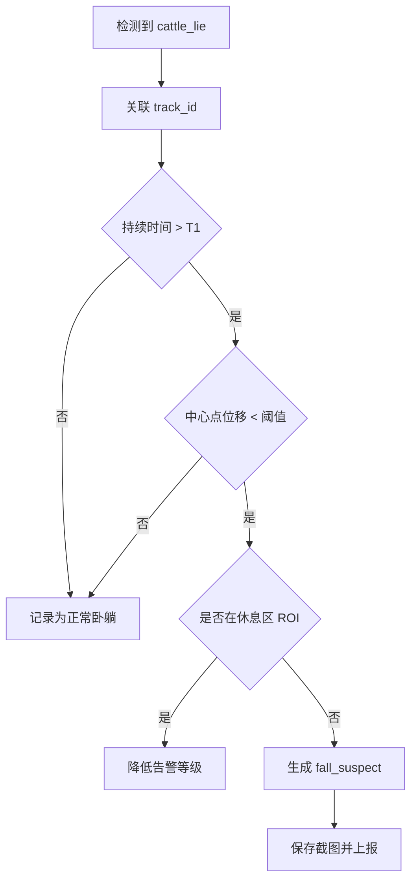

#### 打斗/剧烈活动

```text
多目标中心点速度升高
+ 两个以上 bbox 快速接近
+ bbox 重叠率升高
+ 持续 2 到 5 秒
= fight_suspect
```

第一期建议把打斗写成“疑似剧烈活动识别”，避免承诺过高。

#### 采食/饮水

```text
人工标定饲槽 ROI/饮水 ROI
检测 cattle_head 或牛体进入 ROI
持续停留超过阈值
记录一次采食/饮水访问
统计访问次数和停留时长
```

不建议第一期承诺精确采食量。

### 8.7 声音 AI 训练流程

声音模型目标不是识别“某一种确定疾病”，而是识别与疾病相关的声音事件，例如咳嗽、喘鸣、异常叫声、呼吸急促等。

#### 数据采集

采集设备：

- ESP32-S3 + I2S 数字麦克风，用于固定点位长期采集。
- 手机/录音笔，用于近距离补采高质量样本。
- 牛舍摄像头时间戳同步，用于把声音和画面事件对齐。

采集场景：

- 正常背景噪声：风扇、饮水、采食、人员走动。
- 正常牛叫声。
- 疑似咳嗽。
- 疑似喘鸣/呼吸音异常。
- 夜间安静环境。
- 高氨气、高湿度等环境异常时段。

采样建议：

- 采样率：16 kHz 或 32 kHz。
- 单段长度：1 到 3 秒。
- 保存格式：训练阶段用 WAV，部署阶段可只保存事件片段。
- 每类有效样本至少 300 到 500 段，背景噪声样本要更多。

#### 标注方式

音频标签建议：

```text
background
normal_moo
cough_suspect
wheeze_suspect
heavy_breathing_suspect
human_noise
machine_noise
```

标注工具：

- Audacity：人工截取音频片段。
- Label Studio：事件级标注。
- Praat：需要分析声学特征时使用。

标注原则：

- 不确定的样本标为 `uncertain`，不要强行归类。
- 背景噪声要单独标注，否则模型会把风扇声误判为呼吸异常。
- 咳嗽和喘鸣最好有视频证据或人工现场记录辅助确认。

#### 特征与模型

推荐训练路线：

```text
WAV 音频
  -> 静音裁剪/VAD
  -> 降噪
  -> Log-Mel 频谱或 MFCC
  -> 轻量 CNN / MobileNetV2
  -> 分类输出
```

部署策略：

- V1：ESP32-S3 只做 VAD 和事件截取，音频分类可在后端或本地电脑训练验证。
- V2：将轻量 TFLite Micro 模型部署到 ESP32-S3，实现咳嗽/背景噪声二分类。
- V3：多类别声音模型部署，结合 MaixCam 视觉证据做健康风险融合。

#### 音频增强

训练时加入：

- 风扇噪声混合。
- 人声/脚步声干扰。
- 不同距离音量变化。
- 随机增益。
- 时间偏移。
- 背景噪声叠加。

这样可以减少牛舍实际噪声导致的误报。

### 8.8 皮肤、眼睛、鼻部视觉训练流程

皮肤、眼睛、鼻部异常识别比普通姿态识别更难，必须明确采集条件。固定高位 MaixCam 可以识别姿态和大体表异常，但对眼睛、鼻子、皮肤细节的识别能力有限。合理方案是：

- MaixCam 固定点位：负责姿态、活动水平、明显创伤/大面积皮肤异常、鼻部明显分泌物疑似。
- 近距离补拍：通过手机、手持摄像头或定点近距离 MaixCam，用于眼睛、鼻子、皮肤细节识别。
- 系统输出“疑似异常风险”，不输出确诊结论。

#### 视觉类别设计

目标检测类别建议：

```text
cattle_body
cattle_head
eye_region
nose_region
skin_lesion_suspect
wound_suspect
nasal_discharge_suspect
eye_discharge_suspect
lameness_posture_suspect
```

第一期建议实际训练：

```text
cattle_body
cattle_head
cattle_lie
skin_lesion_suspect
nasal_discharge_suspect
eye_discharge_suspect
```

不建议一开始训练过多细分类。皮肤病、眼病、鼻部异常都存在样本稀缺和标注主观性问题。

#### 数据采集要求

皮肤样本：

- 正常皮肤/毛色。
- 脱毛。
- 红肿。
- 伤口。
- 结痂。
- 泥污干扰样本。

眼部样本：

- 正常眼部。
- 流泪。
- 分泌物。
- 红肿。
- 半闭眼/精神差疑似。

鼻部样本：

- 正常鼻镜。
- 清鼻液。
- 脓性分泌物疑似。
- 鼻镜干燥/污物干扰。

每类建议：

- V1 最低 200 到 300 张有效样本。
- 正常样本数量要多于异常样本。
- 异常样本不足时，先做“异常疑似二分类”，不要细分具体病种。

#### 模型路线

推荐两级模型：

```text
第一级：YOLO 检测牛体/头部/眼鼻/异常区域
第二级：局部裁剪图像分类
```

流程：

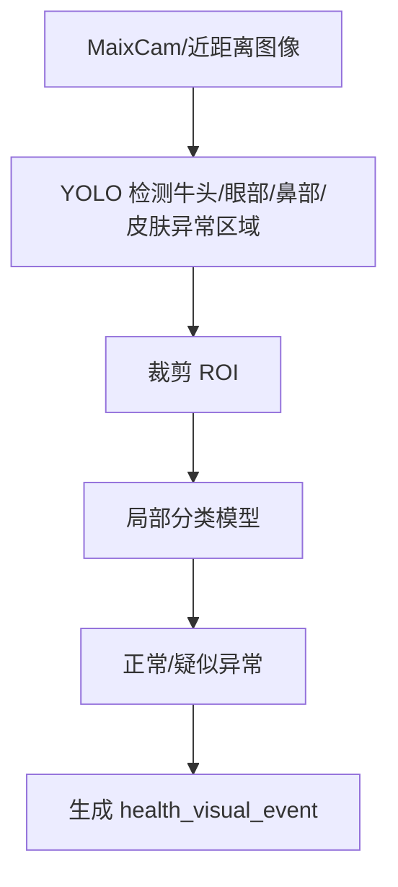

模型选择：

- 检测：YOLOv8n。
- 局部分类：MobileNetV3-small、EfficientNet-lite、ResNet18。
- 端侧部署：优先把检测放在 MaixCam；局部细分类可先在后端跑，稳定后再端侧化。

### 8.9 姿态与运动异常训练流程

姿态不只用于跌倒，也可以辅助疾病风险判断。病牛常见表现包括活动减少、长时间卧地、站姿异常、跛行、头部低垂等。

可落地路线：

```text
YOLO 检测牛体
  -> 目标跟踪 track_id
  -> 统计活动距离、卧地时长、起卧次数
  -> 姿态分类：站立/卧地/低头/异常站姿疑似
  -> 与声音和局部视觉融合
```

指标：

- 单牛精确身份识别第一期不做硬承诺。
- 以栏位或画面内 track 为单位统计健康风险。
- 如果需要长期个体追踪，二期增加耳标识别或项圈节点。

### 8.10 多模态融合训练与规则

第一期推荐使用“规则融合 + 可解释评分”，不要直接训练黑盒多模态大模型。原因是数据量不足，且疾病标签难以可靠获得。

融合输入：

| 模态 | 特征 |
|---|---|
| 环境 | 温度、湿度、氨气趋势、烟雾、光照 |
| 声音 | 咳嗽次数、喘鸣置信度、异常叫声频次、持续时间 |
| 姿态 | 卧地时长、活动量下降、起卧频次、异常站姿 |
| 局部视觉 | 皮肤异常、眼部分泌物、鼻部分泌物、明显创伤 |
| 历史趋势 | 同栏位/同 track 最近 24h 异常次数 |

规则示例：

```text
if cough_suspect_count_1h >= 3
and nasal_discharge_suspect_score > 0.6:
    respiratory_risk = warning

if cough_suspect_count_1h >= 3
and nh3Status == high
and humidity > threshold:
    respiratory_risk = warning

if long_lie_duration > 3h
and activity_drop_24h > 50%
and eye_discharge_suspect_score > 0.6:
    health_risk = warning

if wound_suspect_score > 0.75:
    skin_risk = warning
```

评分方式：

```text
risk_score =
  0.30 * audio_score
+ 0.30 * visual_local_score
+ 0.20 * posture_score
+ 0.10 * environment_score
+ 0.10 * history_score
```

权重可以在现场试点后调整。申报书中建议写“可配置融合权重”，不要写固定不可变。

### 8.11 健康风险标签体系

建议输出风险，不输出疾病名称：

| 输出类型 | 含义 |
|---|---|
| respiratory_risk | 呼吸道疾病风险 |
| skin_risk | 皮肤/体表异常风险 |
| eye_risk | 眼部异常风险 |
| nasal_risk | 鼻部异常风险 |
| lameness_risk | 跛行/运动异常风险 |
| stress_risk | 应激/异常状态风险 |
| unknown_health_risk | 多项异常但无法归类 |

每条告警必须带证据：

- 声音事件片段。
- 视觉截图。
- 检测框。
- 置信度。
- 环境数据。
- 持续时间。

这样评审和现场用户能理解系统为什么报警。

## 9. ESP32-S3 固件设计

### 9.1 软件框架

推荐使用 `ESP-IDF`，比 Arduino 更适合项目工程化。

任务划分：

| FreeRTOS 任务 | 周期 | 作用 |
|---|---:|---|
| sensor_task | 1s 到 5s | 读取 I2C/ADC/RS485 传感器 |
| control_task | 200ms 到 1s | 阈值判断和执行器控制 |
| mqtt_task | 5s 到 60s | 数据上报、命令订阅 |
| uart_maix_task | 100ms | 与 MaixCam 通信 |
| audio_task | 20ms 到 100ms | I2S 音频采集、VAD、声音事件检测 |
| display_task | 1s | LCD/OLED 刷新 |
| watchdog_task | 1s | 系统健康检查 |
| storage_task | 事件触发 | 离线缓存关键数据 |

### 9.2 本地控制规则

示例：

```text
if nh3Status == high:
    fan = ON
    alarm = ON if duration > 60s
    send capture_request to MaixCam

if temperature > highTemp and humidity > highHumidity:
    fan = ON
    atomizer = conditional

if fireDetected or smokeHigh:
    fan = OFF depending fire strategy
    alarm = ON
    upload urgent alert
```

火情策略要谨慎：有些火情场景不应继续通风助燃，项目中应写“按预设安全策略联动”，不要简单固定为开风扇。

### 9.3 远程参数配置

云端可下发：

- 温湿度阈值。
- 氨气原始值阈值。
- 告警持续时间。
- MQTT 上报周期。
- MaixCam 抓拍触发策略。
- 风扇/雾化器自动/手动模式。

ESP32-S3 本地保存配置到 NVS，重启后继续生效。

## 10. MaixCam 边缘 AI 程序设计

### 10.1 程序流程

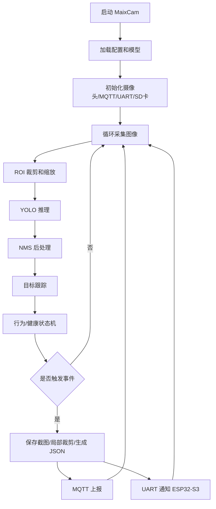

### 10.2 配置项

```json
{
  "cameraId": "cam_01",
  "model": "yolov8n-cattle-v1.mud",
  "healthModel": "cattle-health-local-v1.mud",
  "scoreThreshold": 0.55,
  "iouThreshold": 0.45,
  "fallSeconds": 180,
  "fightSeconds": 3,
  "healthScoreThreshold": 0.65,
  "localCropUpload": true,
  "roi": [[30, 40], [300, 40], [300, 220], [30, 220]],
  "mqttUploadImage": true,
  "uartNotify": true
}
```

### 10.3 健康视觉程序策略

MaixCam 的固定高位视角优先做以下任务：

- 牛体姿态：站立、卧倒、低活动。
- 牛头检测：为眼睛、鼻部进一步识别提供 ROI。
- 明显体表异常：大面积脱毛、伤口、红肿、污物遮挡疑似。
- 局部截图：当检测到牛头靠近、画面清晰度达标时，裁剪眼鼻区域上传。

对眼睛、鼻子、皮肤细节，建议分两种模式：

| 模式 | 数据来源 | 用途 |
|---|---|---|
| 固定 MaixCam 模式 | 高位俯视/侧视 | 姿态、活动量、明显体表异常 |
| 近距离巡检模式 | 手持手机/近距摄像头/低位 MaixCam | 眼睛、鼻子、皮肤细节筛查 |

判断图像是否可用于健康细节识别：

- 牛头或局部区域面积足够大。
- 图像清晰，无严重运动模糊。
- 光照不过曝/欠曝。
- 目标遮挡不严重。

不满足条件时，只记录“无法判断”，不要强行输出疾病风险。

## 11. 后端与前端适配

### 11.1 后端新增数据表

建议新增：

```text
camera_device
vision_event
vision_snapshot
audio_event
health_risk_event
health_evidence
model_version
device_config
```

`vision_event` 字段：

- id
- barn_id
- camera_id
- event_type
- level
- score
- track_id
- bbox
- duration_sec
- snapshot_path
- model_version
- created_at

`audio_event` 字段：

- id
- barn_id
- device_id
- event_type
- score
- duration_ms
- snr
- audio_clip_path
- model_version
- created_at

`health_risk_event` 字段：

- id
- barn_id
- target_id
- risk_type
- risk_level
- score
- evidence_json
- suggestion
- status
- created_at

### 11.2 前端新增功能

- 环境实时数据面板。
- 执行器状态和远程控制。
- 视觉事件列表。
- 声音事件列表：咳嗽、喘鸣、异常叫声。
- 健康风险中心：按栏位、风险类型、等级聚合。
- 事件详情：截图、置信度、持续时间、处理状态。
- 健康证据链：声音片段、眼鼻/皮肤截图、姿态趋势、环境数据。
- 摄像头状态：在线/离线/FPS/模型版本。
- ROI 和阈值配置页面。
- 健康风险阈值配置：咳嗽次数、卧地时长、融合权重。

## 12. 现场部署方案

### 12.1 设备位置

| 设备 | 安装位置 |
|---|---|
| ESP32-S3 控制箱 | 离地 1.5m 以上，远离水槽和冲洗区 |
| 温湿度传感器 | 牛呼吸高度附近，避开直吹和水雾 |
| 氨气传感器 | 粪污区上方但避免贴地积水 |
| MaixCam | 2.5m 到 3.5m 高处，俯视 30 到 45 度 |
| I2S 麦克风 | 远离风扇直吹和金属震动源，尽量靠近目标栏位 |
| 近距离巡检摄像 | 牛头/牛体侧面可接近位置，作为人工复核补拍 |
| 补光灯 | 避免直射镜头，覆盖监测 ROI |
| 风扇/雾化器 | 根据牛舍气流布置 |

### 12.2 防护要求

- 控制箱 IP65。
- 摄像头透明窗口加遮雨沿。
- 所有外部线缆使用防水接头。
- 强电和弱电分区。
- 传感器可拆卸，便于维护和标定。
- MaixCam 留散热空间，防止夏季高温死机。
- 麦克风需要防水透声膜，避免水汽、粉尘和高压冲洗损坏。
- 健康细节识别需要定期清洁镜头窗口，否则皮肤、眼鼻判断会失效。

## 13. 测试验收指标

### 13.1 硬件与通信

| 指标 | 目标 |
|---|---:|
| 实验室连续运行 | >= 72 小时 |
| 牛舍试点运行 | >= 7 天 |
| MQTT 断线重连 | 自动恢复 |
| 环境数据上报周期 | 5 到 60 秒可配 |
| 本地告警响应 | <= 1 秒 |
| 视觉事件响应 | 3 到 10 秒可配 |
| 声音事件响应 | 1 到 5 秒可配 |
| 执行器误动作 | 0 次作为目标 |

### 13.2 AI 识别

| 指标 | V1 目标 |
|---|---:|
| 牛只检测 Precision | >= 85% |
| 牛只检测 Recall | >= 85% |
| 卧倒检测 Recall | >= 80% |
| 人员检测 Precision | >= 90% |
| 疑似异常事件可解释率 | 100% 事件有截图和置信度 |
| 现场误报闭环 | 每周回收样本并优化 |

### 13.3 声音与健康风险筛查

| 指标 | V1 目标 |
|---|---:|
| 咳嗽/背景噪声二分类 Recall | >= 75% |
| 咳嗽/背景噪声二分类 Precision | >= 75% |
| 声音事件证据留存 | 100% 告警保留音频片段或特征 |
| 健康风险事件证据链 | 100% 包含至少两类证据或明确单项强证据 |
| 皮肤/眼鼻异常筛查 | 先做疑似异常提示，不做确诊 |
| 人工复核闭环 | 每条高风险事件支持标记真/假阳性 |

不建议写“识别准确率 100%”。真实场景存在遮挡、粉尘、夜间噪声和牛只重叠，100% 不可信。

## 14. 项目阶段计划

### 第 1 阶段：ESP32-S3 替换验证，1 到 2 周

交付物：

- ESP32-S3 采集 AHT20/BH1750/MQ-137。
- ESP32-S3 控制风扇/报警。
- ESP32-S3 MQTT 上报。
- ESP32-S3 与 MaixCam UART 通信 demo。

### 第 2 阶段：MaixCam 开源模型跑通，1 到 2 周

交付物：

- YOLOv8n 官方模型训练流程。
- MaixCam 端推理 demo。
- 视觉事件 JSON 输出。

### 第 3 阶段：本地牛舍数据集，3 到 6 周

交付物：

- 牛舍图片数据集。
- 牛舍声音数据集。
- 皮肤、眼睛、鼻部近距离补拍数据集。
- YOLO 标注文件。
- 音频事件标注文件。
- V1 牛只检测模型。
- V1 咳嗽/背景噪声二分类模型。
- 模型评估报告。

### 第 4 阶段：系统联调，2 到 4 周

交付物：

- ESP32-S3 + MaixCam + MQTT + 后端 + 前端完整链路。
- 环境异常触发抓拍。
- 声音异常触发视觉抓拍。
- 视觉异常触发本地声光报警。
- 健康风险融合告警。
- 断网缓存与恢复。

### 第 5 阶段：现场试点与优化，2 到 4 周

交付物：

- 7 天牛舍运行报告。
- 误报/漏报样本分析。
- 二次训练模型。
- 健康风险人工复核记录。
- 最终测试报告。

## 15. 申报书替换建议

### 15.1 主控替换表述

原：

> 以 STM32L476RG 低功耗单片机为核心控制单元。

建议改为：

> 以 ESP32-S3 物联网主控芯片为核心控制单元，集成 WiFi/BLE 无线通信能力，完成牛舍环境数据采集、执行器联动控制、本地告警、MQTT 数据上传和远程参数配置。相比传统 MCU 外接通信模块的方案，ESP32-S3 可减少硬件复杂度，提高端云通信稳定性，并为后续项圈节点接入和轻量化边缘智能扩展预留能力。

### 15.2 MaixCam 表述

> 视觉健康监测模块采用 Sipeed MaixCam 边缘 AI 摄像头，基于开源 YOLO 目标检测模型进行二次训练和端侧部署，实现肉牛站立、卧倒、人员进入等状态识别。系统结合目标跟踪、ROI 区域约束、多帧投票和时间状态机，自主优化疑似跌倒、长时间静止、剧烈活动等异常事件判定逻辑，降低牛舍弱光、遮挡和粉尘环境下的误报率。

### 15.3 数据传输表述

> 系统采用 MQTT 作为端云通信协议，ESP32-S3 周期上报温湿度、氨气趋势、光照、火情等环境数据，并接收云端下发的阈值和控制参数；MaixCam 在本地完成视觉 AI 推理，仅上传事件类型、置信度、检测框、截图路径等结构化结果，避免视频流长期上传造成的带宽压力。ESP32-S3 与 MaixCam 之间通过 UART 交换抓拍指令和本地告警事件，实现环境异常与视觉留证的联动。

### 15.4 AI 训练表述

> 算法层采用开源 YOLOv8n 作为基础检测模型，通过合作牛场采集的肉牛图像数据进行迁移训练，构建覆盖白天、夜间、补光、遮挡、站立、卧躺等场景的数据集。训练完成后将模型转换并部署至 MaixCam 端侧运行。项目在开源模型基础上自主设计牛舍 ROI 约束、多帧投票、目标跟踪、异常状态机和误报样本回流优化机制，形成适配肉牛养殖场景的边缘视觉识别算法。

### 15.5 多模态健康风险筛查表述

> 在健康风险筛查方面，系统新增声音采集与多模态融合分析模块。ESP32-S3 通过 I2S 数字麦克风采集牛舍声音，基于开源音频特征提取与轻量分类模型识别咳嗽、喘鸣、异常叫声等疑似健康异常信号；MaixCam 结合开源 YOLO 检测模型与自建牛舍数据集，识别肉牛姿态、活动量、明显皮肤异常、眼鼻分泌物等视觉特征。系统不直接给出疾病确诊结论，而是融合声音、视觉、环境和历史趋势数据，生成呼吸道风险、皮肤/体表异常风险、眼鼻异常风险、运动异常风险等分级预警，并保留音频片段、截图、置信度和环境数据作为人工复核依据。

## 16. 最小可落地版本

第一期必须实现：

- ESP32-S3 采集温湿度、氨气趋势、光照、火情/烟雾。
- ESP32-S3 控制风扇、雾化器、声光报警。
- ESP32-S3 通过 MQTT 上传环境数据。
- MaixCam 运行 YOLOv8n 牛只检测模型。
- MaixCam 输出卧倒/疑似异常事件。
- ESP32-S3 采集牛舍声音，并完成咳嗽/背景噪声初步识别或事件截取。
- MaixCam 对姿态、明显皮肤异常、眼鼻异常疑似进行截图和风险提示。
- 后端融合声音、视觉、环境数据生成健康风险等级。
- ESP32-S3 与 MaixCam 通过 UART 联动。
- 后端和前端展示环境数据、视觉事件和告警截图。
- 72 小时实验室运行和 7 天现场试点。

第二期再做：

- 打斗/剧烈活动识别。
- 饲槽/饮水 ROI 行为统计。
- 眼睛、鼻子、皮肤局部细分类模型端侧部署。
- 近距离巡检小程序或手机端补拍上传。
- 工业 NH3 传感器。
- 4G 路由器。
- 项圈 IMU 节点。
- OTA 升级和模型远程管理。

## 17. 关键落地判断

ESP32-S3 替换 STM32 是合理的，尤其适合这个项目的“端云一体、低成本、易部署”叙述。但替换后要同步调整申报书逻辑：

1. 不再写 `STM32 + ESP8266`，改成 `ESP32-S3 原生 WiFi/BLE 主控`。
2. 不把 ESP32-S3 写成视觉 AI 主力，视觉 AI 仍由 MaixCam 负责。
3. 不承诺整机超低功耗，改写为分层功耗和事件触发推理。
4. 不承诺 100% 准确率，改写为 Precision、Recall、误报闭环和现场试点指标。
5. 把“使用开源算法”写成“开源 YOLO/音频分类基础模型 + 牛舍数据迁移训练 + 自主规则优化”，这样技术路线更可信，也更容易验收。
6. 疾病相关功能写成“健康风险筛查与人工复核”，不要写成“自动确诊牛病”。
