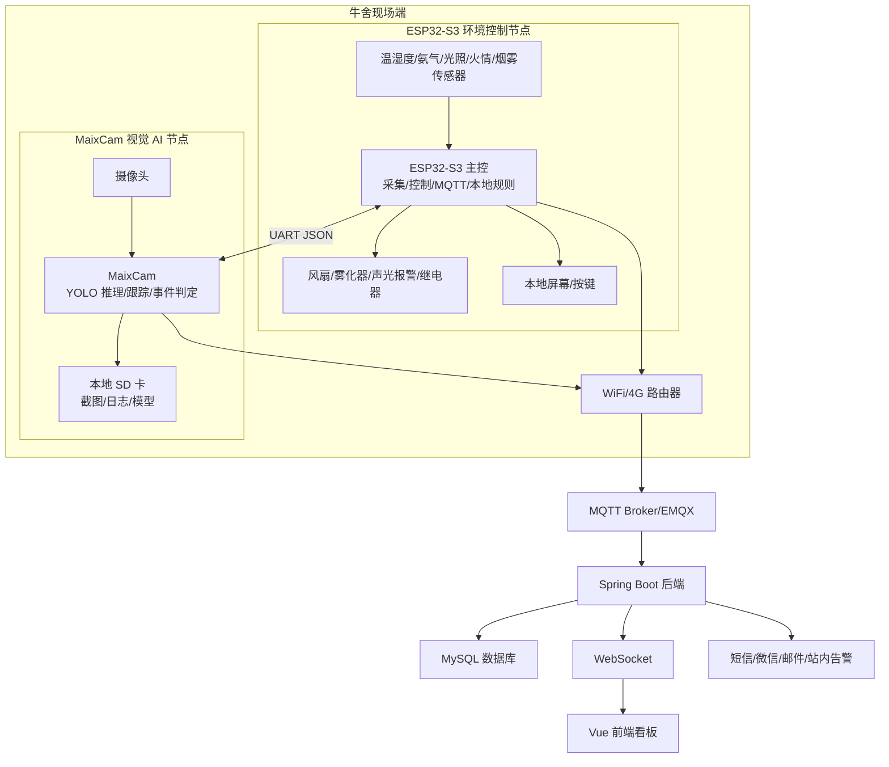
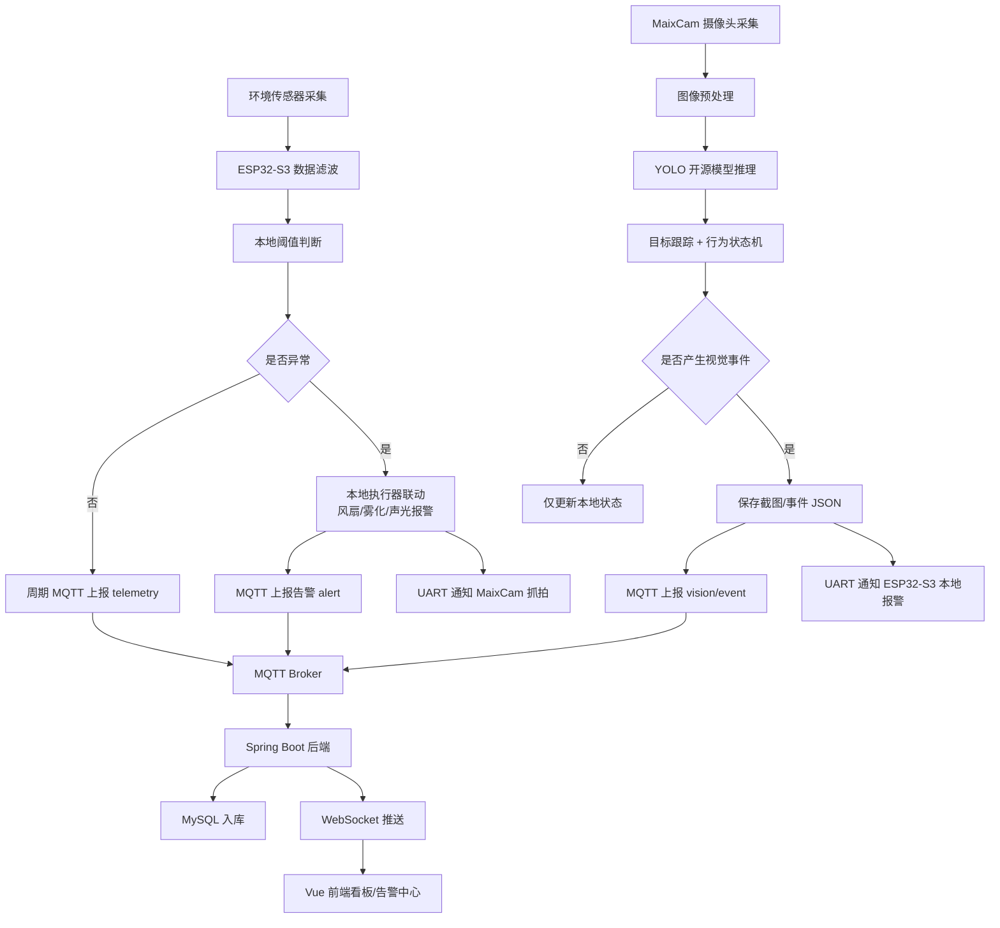
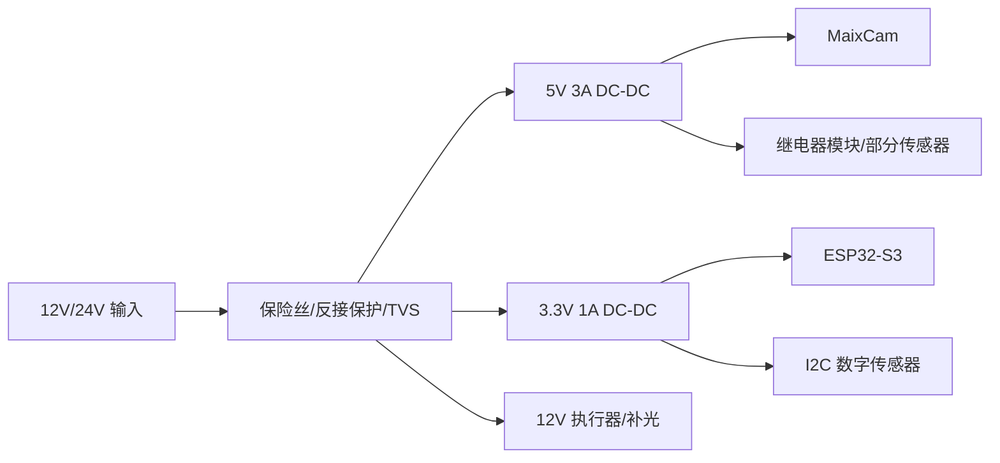
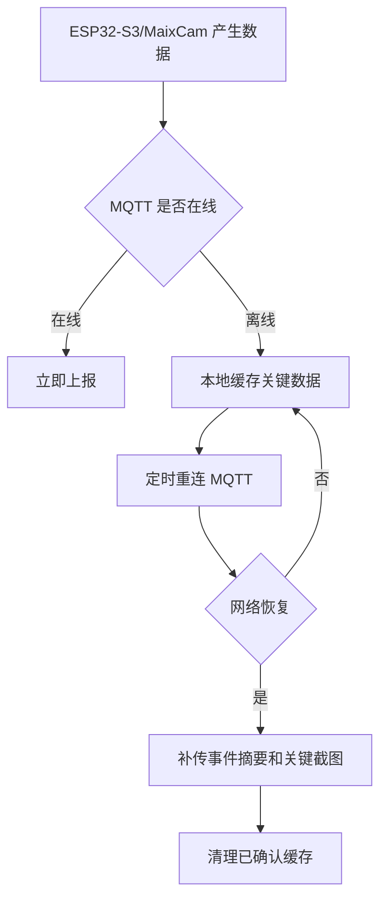
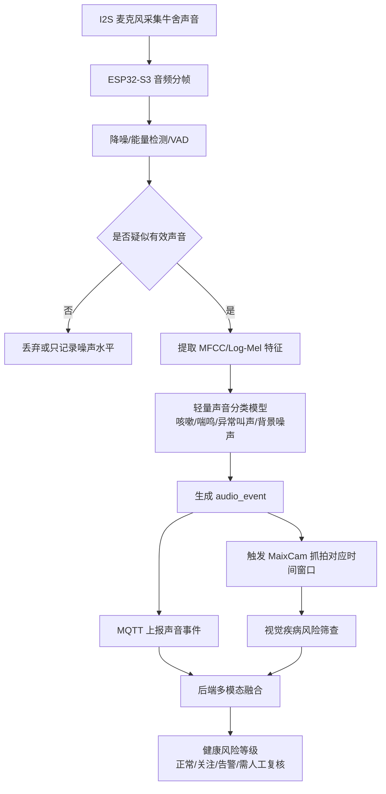
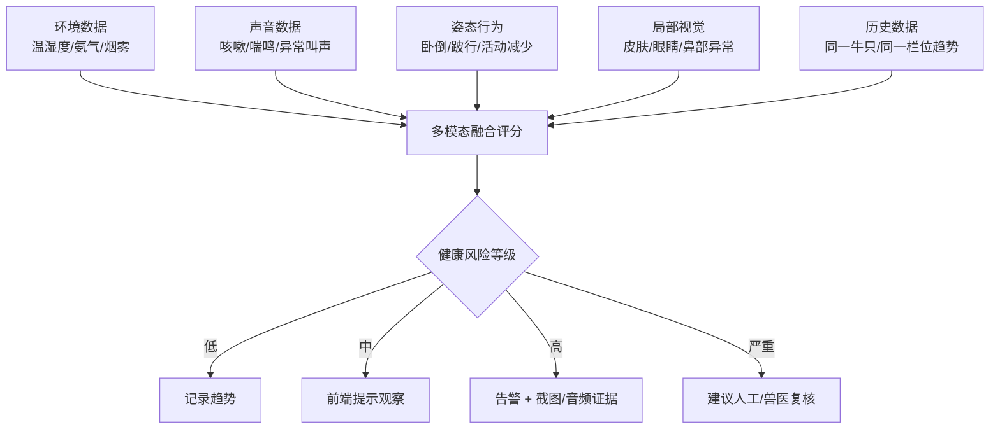

# Mermaid 流程图可显示版

说明：下面每个图都必须放在 ` ```mermaid ` 代码块中。普通 Word、普通文本框和部分 Markdown 编辑器不会自动渲染 Mermaid。

## 1. 系统总体架构



## 2. 全链路数据流



## 3. 供电流程



## 4. 断网缓存流程



## 5. 声音与疾病风险数据流



## 6. 多模态疾病风险判断


