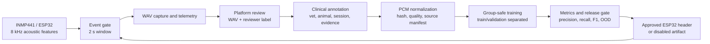

# 牛声音健康风险筛查：论文依据与生产落地说明

检索与实现日期：2026-07-19。本文把“声音判断”限定为健康风险筛查中的
声学事件识别，不把它表述为疾病确诊或自动治疗依据。

## 论文依据

| 文献 | 可支持的工程结论 | 项目中的对应实现 |
| --- | --- | --- |
| Ferrari, Piccinini, Silva et al., *Cough sound description in relation to respiratory diseases in dairy calves*, Preventive Veterinary Medicine, 2010, [DOI](https://doi.org/10.1016/j.prevetmed.2010.06.013), [PMID 20633937](https://pubmed.ncbi.nlm.nih.gov/20633937/) | 犊牛咳嗽声音与呼吸道疾病临床情形有关，咳嗽可作为值得记录和复核的声学事件。 | 标签使用 `cough_suspect`，而不是把音频直接命名为某一种疾病。 |
| Vandermeulen, Bahr, Johnston et al., *Early recognition of bovine respiratory disease in calves using automated continuous monitoring of cough sounds*, Computers and Electronics in Agriculture, 2016, [DOI](https://doi.org/10.1016/j.compag.2016.07.014), [PMID 32287575](https://pubmed.ncbi.nlm.nih.gov/32287575/) | 连续咳嗽监测有早期识别牛呼吸道风险的研究基础。 | ESP32 每 2 秒分析一次，候选事件留存音频片段并限制重复告警频率。 |
| Costa, Cantor, Neave et al., *Symposium review: Precision technologies for dairy calves and management applications*, Journal of Dairy Science, 2021, [DOI](https://doi.org/10.3168/jds.2019-17885), [PMID 32713704](https://pubmed.ncbi.nlm.nih.gov/32713704/) | 精准养殖健康监测应依赖连续记录和管理流程，单一传感器不应成为最终临床结论。 | 后端保存声音、温湿度、红外体温、运动和视觉证据，供人工复核。 |
| Limede, Marques, Cidrini et al., *Using audio-visual monitoring to evaluate immune and behavioral indicators to lipopolysaccharide challenge in beef cattle*, Journal of Animal Science, 2025, [DOI](https://doi.org/10.1093/jas/skaf345), [PMID 41072936](https://pubmed.ncbi.nlm.nih.gov/41072936/) | 牛健康状态研究可采用音频与视觉、行为等多模态数据联合解释。 | 呼吸风险只有在声音候选与体温、视觉、行为或环境趋势共同支持时才升级。 |
| Jobarteh, Mincu-Iorga, Gavojdian et al., *Integrating multi-modal data fusion approaches for analysis of dairy cattle vocalizations*, Frontiers in Veterinary Science, 2025, [DOI](https://doi.org/10.3389/fvets.2025.1704031), [PMID 41334225](https://pubmed.ncbi.nlm.nih.gov/41334225/) | 牛发声分析应结合上下文，不宜仅凭单段音频推断健康状态。 | 网页端保留 WAV 回放、审核标签、模型版本、置信度和现场说明。 |
| Schook, et al., *Sound analysis in dairy cattle vocalisation as a potential welfare monitor*, Computers and Electronics in Agriculture, 2015, [DOI](https://doi.org/10.1016/j.compag.2015.08.028) | 牛叫声的频谱和时序特征可用于福利/状态监测研究，但不等同于疾病确诊。 | 公开牛叫数据只训练“牛声存在”基础模型，不参与疾病标签。 |

这些论文支持的逻辑链是：**声音事件出现 -> 形成可回放的风险线索 ->
与多模态和临床证据复核 -> 人工或兽医做处置决定**。它们不支持把普通
牛叫数据直接标注成肺炎、喘鸣或任何疾病。

## 公开数据审计

已检索并实际下载的数据源：

- [Animal Sounds Classification (ASC24)](https://www.kaggle.com/datasets/haithammoh/sounds-of-animals)，声明许可证为 CC0。下载版本包含 114 段 Cow、156 段 Dog、104 段 Frog 音频。
- 已下载归档 SHA-256：`651b58457d66a96ff0ced2139926935242d816f6396a31cab83c745c0df34670`。
- 原始扩展名为 WAV，但编码并非部署可直接读取的 PCM；准备流程已统一转为 8 kHz、单声道、16-bit PCM。
- 374 段中，18 段因时长小于 0.5 秒、4 段因饱和比例超过 2%、30 段因转码后内容完全重复被拒绝，保留 322 段。它们的用途严格限于 `cow_vocalization` 和 `non_cattle_audio` 基础模型。
- 检查过 [SINC grazing jaw movements repository](https://github.com/sinc-lab/dataset-jaw-movements)，其公开仓库没有声明许可证，因此已经登记为禁止使用，未加入训练。

本次可核验的公开检索没有找到一个同时具备以下条件的可直接发布数据集：
牛种明确、咳嗽/喘鸣事件标签、临床或兽医来源、可商用许可、可验证的
动物/场次切分。论文中的疾病声音数据往往不公开或不带上述全部信息。因
此，生产发布所需的呼吸事件数据必须由试点牛场按本项目硬件安装方式采集。

## 已实现的生产链路

代码位置：

- 来源登记与许可证约束：[audio_dataset_sources.json](tools/audio_dataset_sources.json)
- 下载数据规范化：[prepare_audio_dataset.py](tools/prepare_audio_dataset.py)
- 复核音频导出与清单：[export_reviewed_audio_dataset.py](tools/export_reviewed_audio_dataset.py)
- 临床签核合并：[verify_clinical_audio_manifest.py](tools/verify_clinical_audio_manifest.py)
- 模型训练、验证、头文件导出：[train_audio_model.py](tools/train_audio_model.py)

每一条训练清单都记录来源、标签、原始与规范化 SHA-256、动物/分组、审核
状态、录音路径和质量信息。准备阶段阻止空音频、过短片段、严重饱和、未知
来源类别和哈希不一致的归档进入训练；训练阶段还会拒绝跨标签或跨动物组的
重复内容。

训练器按 `groupId` 隔离训练与验证。公开数据中的同一原始录音 A/B 片段
不会跨分区；现场临床数据会按 `animalId` 隔离。输出包含混淆矩阵、每类
precision/recall/F1、拒识率、模型卡、数据集指纹和模型版本。

## 发布门禁

只有明确带 `--release` 的训练才可能设置 `kEnabled=true`。下列任一条件不满足，
输出头文件自动保持禁用：

1. 缺少 `cough_suspect` 或指定的临床风险标签。
2. 风险标签样本少于默认 100 条，或验证集中少于 3 个独立动物组。
3. 任一风险样本没有兽医、动物标识、录音会话和临床证据引用。
4. 风险标签来源未显式允许用于疾病风险训练。
5. 验证 macro-F1、风险类 precision 或 recall 未达到配置阈值。

即使通过发布门禁，端侧仍有两道拒绝：Softmax 置信度阈值和到预测类别
特征中心的距离阈值。任一失败时返回 `unknown`，不会产生呼吸道候选事件。

每次 ESP32 启动还会生成 `bootId`，音频事件以
`deviceId + bootId + edgeEventId` 去重。这样串口重传不会重复入库，而设备重启
后的新事件也不会被旧序号错误覆盖。当前实测事件使用 2 秒、8 kHz、单声道、
8-bit PCM（16,000 帧）；后端将其保存为 16,044 字节 WAV，并把串口行上限设为
32 KB 以容纳 Base64 事件。

## 当前可用结果

公开 CC0 数据已训练出 `cattle-vocalization-baseline-v2-bedc334739f4`：

- 验证集 125 个两秒窗口、57 个独立分组。
- `cow_vocalization`：precision `0.815`，recall `0.688`，F1 `0.746`。
- `non_cattle_audio`：precision `0.910`，recall `0.871`，F1 `0.890`。
- macro-F1 `0.818`，置信度门槛 `0.625`，但头文件为 `kEnabled=false`，因为没有 `cough_suspect`
  临床样本。

该结果证明数据、特征、验证、导出和拒识链路可以运行；它不构成呼吸疾病
模型，也不会让蜂鸣器因公开牛叫数据而报警。当前在线 ESP32 因而继续显示
`feature_only`，直到真实临床数据通过发布门禁。
